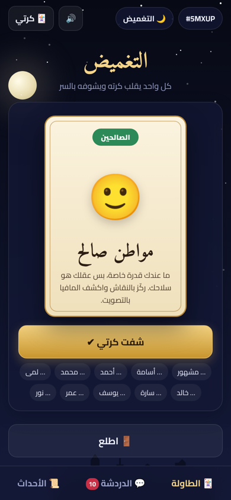
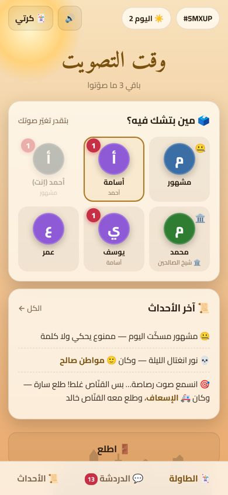

# Mafia Game (لعبة المافيا)

An online multiplayer Mafia party game in Arabic. Every player joins from their own phone using a short room code, no accounts or installs needed. The rules follow the popular Arab YouTube Mafia format.

> لعبة مافيا أونلاين بالعربي — كل لاعب يدخل من جواله بكود الغرفة.

**Play:** https://mas770ur2005-cell.github.io/mafia-game/

  
  

## Roles
**Mafia**
- Mafia Boss (شيخ المافيا): chooses who gets assassinated each night
- Silencer (مافيا التسكيت): silences one player (or himself) for the next day
- Mafia (مافيا)

**Town**
- Town Elder / Mayor (شيخ الصالحين): can reveal his card; his vote then counts as 3
- Good Son (الولد الصالح): takes one player with him when he leaves the game
- Medic (الإسعاف): tries to guess and save the assassination target
- Sniper (القنّاص): one secret bullet; if he hits a citizen, both leave
- Citizens (مواطن صالح)

The Mafia wins when its members equal the remaining town players. The town wins when all Mafia members are out.

## Features
- Random card draw with a flip animation, and a first "eyes closed" night where the Mafia meet each other
- Night actions, morning announcements, discussion and voting timers
- Private Mafia chat at night, a separate chat for eliminated players
- Host settings: number of Mafia, toggle each role, timers, reveal roles on death
- Sound effects and vibration, night/day themes

## Tech
Single HTML file with plain JavaScript and CSS. Players connect peer-to-peer with [PeerJS](https://peerjs.com/) (WebRTC). The host's browser runs the game, so the host should keep the page open.

## Run locally
Just open `index.html` in a browser, or serve the folder with any static server.

## Author
Mashhour Al Batran, Computer Engineering student at the Islamic University of Gaza.
